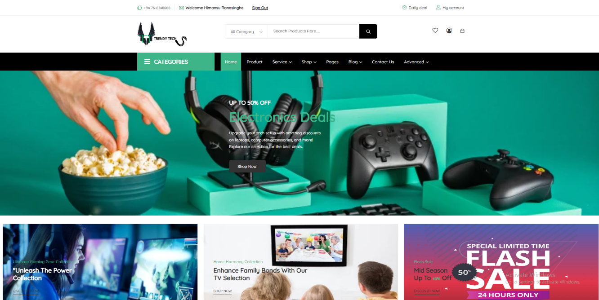
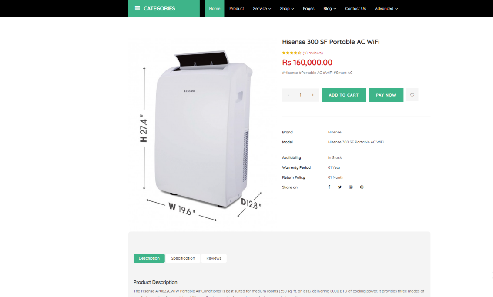
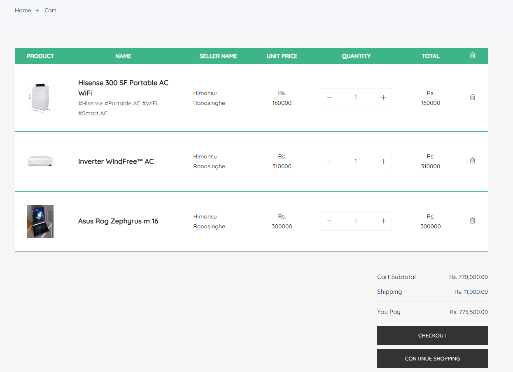
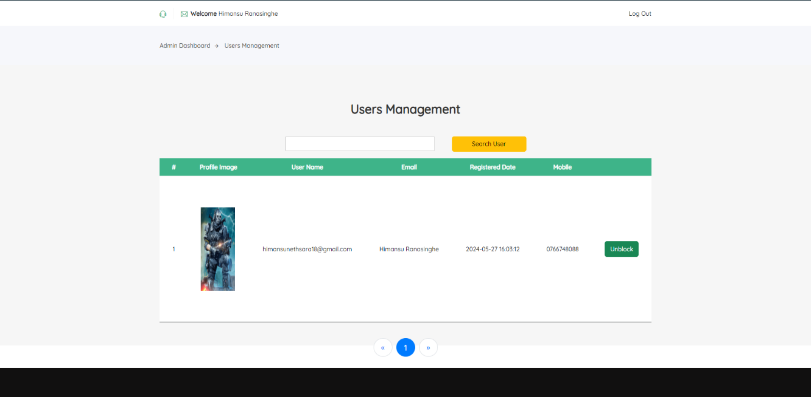
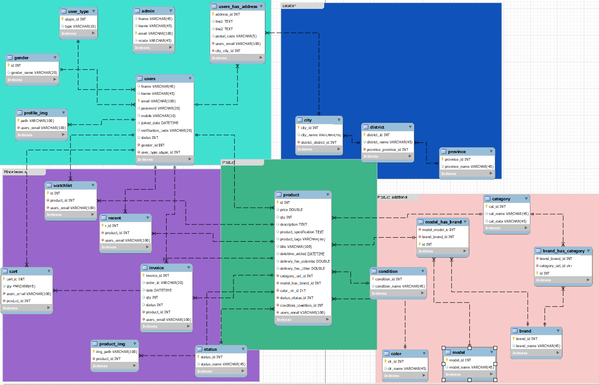

<h1 align="center">💻 New Tech E-Commerce</h1>

  
  
  
  

  <strong>New Tech</strong> is a multi-page e-commerce storefront and admin interface prototype for browsing and purchasing electronics, built using PHP, HTML5, and Bootstrap.

> *Note: This is one of my earliest foundational projects. It was built to explore UI/UX design, multi-page routing, and e-commerce data modeling. While the frontend is fully prototyped, the backend database integration and authentication were designed (see ER Diagram) but not implemented in code.*

---

## 📖 Overview

**New Tech** is a comprehensive frontend prototype for an electronics store. It includes a full customer shopping journey (browsing, cart, checkout, invoices) and a complete administrative dashboard. 

The project uses a static multi-page PHP monolith architecture to stitch together shared headers and footers. Data flows from hardcoded HTML/JavaScript arrays to simulate a fully functioning store without a backend database.

## ✨ Key Features

### 🛍️ Customer Storefront
- **Authentication UI:** Sign-in and sign-up screens (visual only).
- **Product Discovery:** Category tabs, automatic carousels, and advanced search interfaces.
- **Product Details:** Ratings, stock status, warranty info, and quantity controls.
- **Shopping Flow:** Fully designed shopping cart, checkout summary, and invoice layout.
- **User Dashboard:** Watchlist, purchase history, and profile management screens.

### ⚙️ Administrative Panel
- **Dashboard:** Sales, traffic, and customer analytics visualization.
- **Inventory Management:** Add, edit, update, and delete product interfaces.
- **User Management:** View user profiles and transaction reports.

## 🛠️ Technology Stack

| Category | Technologies |
| :--- | :--- |
| **Backend** | PHP (Static routing via `include`) |
| **Frontend** | HTML5, CSS3, Vanilla JavaScript (ES5/ES6) |
| **UI Framework** | Bootstrap 5.3 (CSS), Bootstrap 4.0 (JS) |
| **Icons & Fonts** | Font Awesome 4.7, Bootstrap Icons, Google Fonts (Quicksand) |

## 📸 System Showcase

| Storefront Home | Product Details |
| :---: | :---: |
|  |  |

| Shopping Cart | Admin Dashboard |
| :---: | :---: |
|  |  |

## 🗄️ Database Schema (Architectural Design)

Although the codebase currently uses hardcoded data, a full relational database schema was designed to support future implementation. 

The schema is divided into four main domains:
1. **User Management:** `users`, `user_type`, `admin`, `users_has_address`
2. **Location:** `province`, `district`, `city`
3. **Product Catalog:** `product`, `category`, `brand`, `model`, `condition`, `color`, `profile_img`
4. **E-Commerce Operations:** `cart`, `invoice`, `watchlist`, `recent`, `product_img`

**Entity-Relationship Diagram:**

  

## 🏗️ System Architecture

The project is a **static PHP monolith**:
- **Routing:** Shared header and footer components are injected using PHP `include` statements across `.php` pages.
- **Interactivity:** JavaScript handles client-side view switching (e.g., toggling between Sign-in and Sign-up panels, or Admin dashboard tabs) without reloading the page.
- **Data Flow:** Currently, product, user, and analytics data are hardcoded directly into the HTML for presentation purposes.

## 🚀 Known Limitations & Future Enhancements

*(Note: As an early prototype, the following improvements are required to make this a production-ready application).*
- [ ] **Backend Integration:** Implement PHP server-side CRUD operations and connect to a MySQL database using the provided ER diagram.
- [ ] **Security:** Implement real authentication (password hashing, session management, route guards) to protect the admin panel.
- [ ] **Features:** Replace static data with dynamic database queries for products, cart, and checkout.
- [ ] **Dependencies:** Upgrade Bootstrap JS from v4.0 to v5.3 to match the CSS version and resolve conflicts.
- [ ] **Testing:** Add PHPUnit or browser testing frameworks.

## 👨‍💻 Author

**Himansu Nethsara Ranasinghe**
- 🎓 BSc (Hons) Software Engineering Undergraduate (JIAT / BCU)
- 🔗 [LinkedIn](https://www.linkedin.com/in/himansu-nethsara/)
- 🐙 [GitHub](https://github.com/HimansuNethsara)